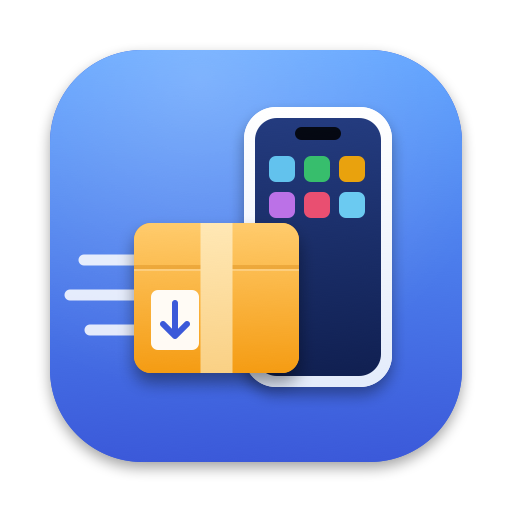
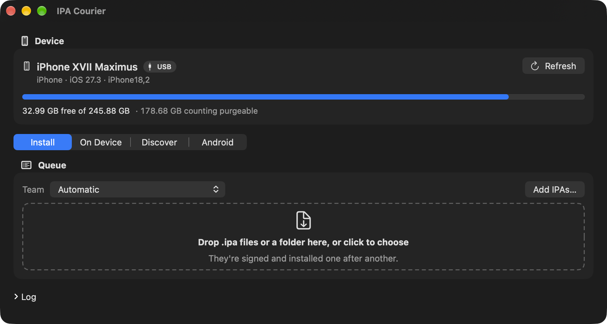
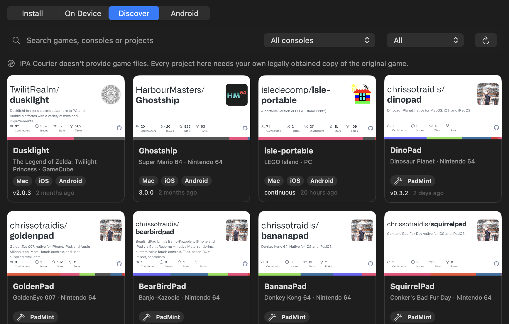
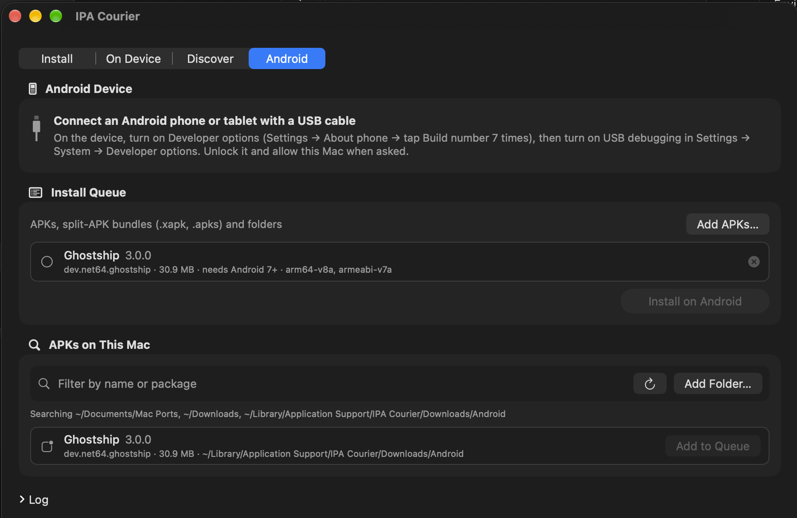

<p align="center">
  
</p>

# IPA Courier

A small macOS app that signs an `.ipa` with your Apple Developer account and
installs it on an iPhone or iPad over USB or Wi-Fi, with a progress bar. It
also sideloads Android apps (`.apk`, `.xapk`, `.apks`) over USB.

<p align="center">
  
</p>

**Download:** the latest signed and notarized build is on the
[Releases page](https://github.com/nickgudauskas/ipa-courier/releases/latest).

## What it does

1. **Device**: detects iPhones and iPads over USB or Wi-Fi (through Apple's
   MobileDevice framework, the same one Finder and Xcode use) and shows the
   connection, name, iOS version, Developer Mode state and free storage. USB is
   used whenever the cable is plugged in.
2. **App**: drop an `.ipa` on the window, click to choose one, or use
   Finder's *Open With → IPA Courier*.
3. **Signing**: picks a development certificate from your keychain and a
   provisioning profile that covers the device and bundle ID. If there isn't
   one, it builds (never installs) a tiny placeholder project with
   `xcodebuild -allowProvisioningUpdates -allowProvisioningDeviceRegistration`,
   so Xcode registers the device and downloads a profile.
4. **Sign & Install**: unpack (with byte-accurate progress), sign nested
   frameworks and extensions, then the app, and verify the signature. Next it
   checks the device's free space (app size + 1 GB margin) and installs with
   `devicectl`, showing its progress.

**Updating existing installs:** once an IPA and device are selected, IPA Courier
lists the device's apps. If the app is already installed, including under a
Sideloadly-style ID with your team ID appended (`com.example.app.ABCDE12345`),
it fills in that bundle ID so installing updates the existing copy and keeps
its data. A bundle ID you type yourself is never replaced. Buttons switch
between the existing copy's ID and the original ID.

**Queue:** add several IPAs at once (or a whole folder). They're signed and
installed one after another, each with its own progress, and a failed or
out-of-space item doesn't stop the rest. Only one unpacked app is kept on disk
at a time.

**On Device tab:** lists every sideloaded app on the connected device with the
date it stops opening, read from the provisioning profiles installed on the
device. It matches each app to an IPA in your IPA folder (or the one IPA
Courier last installed it from). **Re-sign** reinstalls over the same app, so
data is kept. **Re-sign Expiring** and **Re-sign All** queue them up. Apps
expiring within 30 days are flagged on the Device card.

**Memory capabilities:** each queue item can request *Increased Memory Limit*
and *Extended Virtual Addressing*. Wildcard profiles can't grant these, so
IPA Courier has Xcode register or update an explicit App ID with the
capability and create a profile for it. When updating an app whose current
profile has these capabilities (for example ones Sideloadly enabled), they're
turned on automatically so re-signing doesn't drop them.

**Discover tab:** a catalog of 94 community recompilations, decompilation
ports, source ports and emulators with macOS or iOS builds. It ranges from N64,
GameCube and PlayStation recomps (Zelda 64: Recompiled, Melee PC, Symphony
Recomp, Silent Hill PC) to classic PC source ports (DevilutionX, OpenMW, Fallout
CE, VCMI, GZDoom) and emulators (XeniOS, DukeX, ARMSX2). Filter by console or
platform. Each card shows the project's latest GitHub release.

<p align="center">
  
</p>

- **Mac builds** download, unpack (zip, dmg or tar) and install to
  `~/Applications/Games`. If a build isn't notarized by Apple, IPA Courier asks
  whether to allow it to open or to let macOS ask on first launch.
- **iPhone & iPad builds** download to your IPA folder and go straight into the
  install queue to be signed with your account.
- **PadMint projects** publish only a game-free shell, so the card opens
  [PadMint](https://github.com/chrissotraidis/padmint), which builds the
  playable app from your own game file. You then install the result here.

IPA Courier never provides game files: every project needs your own copy of
the original game.

**Android tab:** sideload Android apps over USB with Google's adb.

<p align="center">
  
</p>

- **Device:** shows the connected phone or tablet's model, Android version,
  CPU type and free storage. If USB debugging still needs allowing, it says how.
- **Finding APKs:** searches your IPA folder, Downloads and any folders you add
  for `.apk`, `.xapk` and `.apks` files. It reads each app's real name,
  package, version, minimum Android version and native architectures, and
  marks ones already installed or with an update. You can also drop APKs on
  the window or use Finder's *Open With*.
- **Installing:** IPA Courier checks Android version, CPU type and free space
  first, copies the APK with a progress bar and installs it. Split-APK
  bundles get the right CPU split and their OBB game data copied. Common
  failures get a specific fix. Examples: a copy signed by someone else
  (Uninstall & Install, after a data-loss warning), a newer version installed
  (Install Older Version), or USB installs blocked by the phone's settings.
- **Discover:** 33 catalog projects have Android builds and an **Install on
  Android** button.

If adb isn't already installed (Android Studio or Homebrew), the Android tab
offers to download Google's official Platform Tools (about 16 MB) into IPA
Courier's own folder.

**Updates:** IPA Courier checks this repository's releases once a day. When a
newer version is out, a banner offers **Install & Relaunch** (or to skip that
version). IPA Courier downloads the new version and checks that it's signed by
the same developer, has the same bundle ID and is notarized by Apple. Then it
replaces itself and relaunches. If it can't replace itself (for example, it's
running from the DMG or from a folder you can't write to), the banner offers
the DMG to install by hand instead. **IPA Courier → Check for Updates…** checks
right away.

If there isn't enough space, the signed copy is kept. Free up space, then
click **Re-check & Install** to skip signing. **Export Signed IPA…** saves the
signed app as an `.ipa`.

## Requirements

- Xcode, signed in to your Apple Developer account (Xcode → Settings → Accounts)
- Developer Mode on the device (Settings → Privacy & Security)
- For Wi-Fi: connect the device by USB once, then turn on *Show this iPhone
  when on Wi-Fi* in Finder and *Connect via network* in Xcode → Window →
  Devices and Simulators. Keep the device unlocked and on the same network.
  Large apps install noticeably slower over Wi-Fi.
- For Android: USB debugging on the device (Settings → About phone → tap
  Build number 7 times, then Developer options → USB debugging)
- Not sandboxed: it runs `codesign`, `xcodebuild`, `devicectl` and `unzip`

## Build

```bash
xcodegen generate
xcodebuild -project IPACourier.xcodeproj -scheme IPACourier -configuration Release -derivedDataPath build/dd build
open "build/dd/Build/Products/Release/IPA Courier.app"
```

## Release builds

`scripts/release.sh` builds, signs with the hardened runtime, and notarizes:

```bash
scripts/release.sh           # Developer ID + notarization: opens on any Mac
scripts/release.sh --local   # Apple Development: this Mac only
```

Notarization needs a one-time setup. The steps are at the top of the script:
a Developer ID Application certificate (Xcode → Settings → Accounts → Manage
Certificates) and credentials saved with `xcrun notarytool store-credentials
ipa-courier-notary`.

Unpacked copies go in `~/Library/Caches/IPA Courier/Jobs`. They're removed
when you choose another IPA or quit, and on next launch. Profiles that
IPA Courier fetches are kept in `~/Library/Application Support/IPA Courier/Profiles`.

`Resources/ProvisioningStub` is the placeholder iOS project used to ask Xcode
for profiles.

## Adding a project to the catalog

The catalog is [`Resources/catalog.json`](Resources/catalog.json). Bump its `revision` with every change. The app
downloads it from this repository's `main` branch on launch, so changes reach
everyone without a new release. Its bundled copy is used offline. Each project
names its GitHub repo and, for each platform, a regular expression that picks
the right file from the latest release:

```json
{
  "id": "zelda64recomp",
  "name": "Zelda 64: Recompiled",
  "game": "The Legend of Zelda: Majora's Mask",
  "console": "Nintendo 64",
  "kind": "Recompilation",
  "repo": "Zelda64Recomp/Zelda64Recomp",
  "summary": "One or two sentences about the project.",
  "requires": "What the player has to supply, e.g. their own ROM.",
  "mac": { "asset": "macOS\\.zip$" },
  "ios": { "asset": "\\.ipa$" }
}
```

When several files match, Apple silicon builds (`arm64`, `aarch64`,
`universal`) are preferred. Check a new rule with
`GITHUB_TOKEN=$(gh auth token) python3 scripts/build-release-index.py --health report.md`.
Use `"padmint": true` instead of `"ios"` for projects that PadMint builds.
For projects that publish a platform in its own releases, add a `"tag"`
regular expression to that platform's rule, e.g.
`"ios": { "asset": "\\.ipa$", "tag": "^iOSv" }`: the file then comes from the
newest published release whose tag matches.
Only list projects whose releases are meant to be redistributed and contain no
game files.

Release details and card images come from the `release-index` branch. The
[Update release index](.github/workflows/release-index.yml) workflow rebuilds it
every hour (GitHub skips some scheduled runs when busy) and whenever the
catalog changes. It publishes `releases.json`
and a copy of each project's GitHub preview image. The app then makes a few CDN
downloads instead of one rate-limited API call and one image request per
project. GitHub's image service allows only about 100 images per IP at a time.
Anything missing from the index falls back to GitHub directly.

The same workflow checks every entry. Repos that moved or disappeared, repos
with no releases, and rules that no longer match a file are listed in a
**Catalog health check** issue. The issue updates when the list changes and
closes itself once everything resolves.

## License

IPA Courier is released under the [MIT License](LICENSE). You're free to use,
fork, modify and redistribute it.

The license covers this project's code only. IPA Courier calls Apple software
already on the Mac at runtime, none of which is included or redistributed here:
the private MobileDevice framework (loaded from
`/System/Library/PrivateFrameworks`), plus `codesign`, `xcodebuild`, `devicectl`
and `notarytool` from Xcode. Their use is governed by Apple's own terms. Apple
doesn't document MobileDevice, so a future macOS update could change it.
